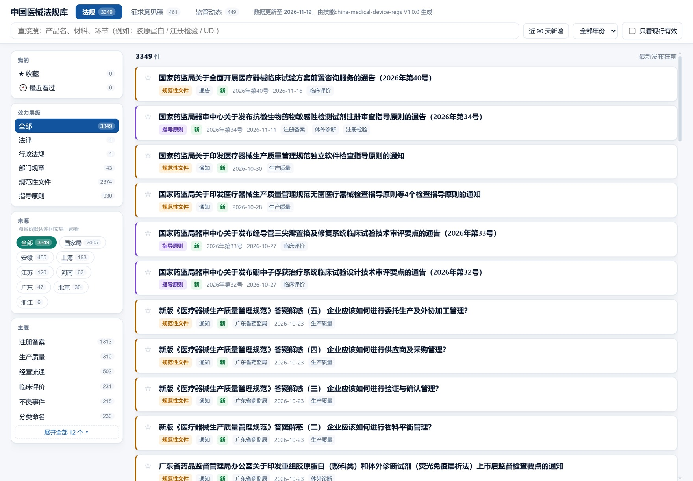

# 中国医械法规库

给医疗器械从业者用的离线法规库：把国家药监局（NMPA）、器审中心（CMDE），以及多个省级药监局官网上的法规文件，收进一个单文件网页，每条都带官方原文链接，点开就能看。

**这是技能，不是数据库**：装好后运行一次，它会去官网抓最新的法规，在本地生成页面。仓库里附带一份初始索引，页面打开就有 **3353 条器械法规**（另有征求意见稿 651 条、监管动态 455 条），不必从零抓取；随时可以重跑，拿到更新的版本。



## 怎么用

两条路，挑一条。

### 一、不用 AI，直接双击

1. 下载本仓库（绿色 `Code` 按钮 → `Download ZIP`），解压到任意位置
2. 双击文件夹里的 `启动.bat`
3. 等它跑完，自动打开网页

首次运行会自动下载便携版 Python（约 11 MB）和抓取组件（约 200 MB），之后每次只补新增的几条，通常 1 分钟内跑完。

装着的东西全在这个文件夹里，不往系统里写东西 —— 删掉文件夹就等于卸载干净。

### 二、交给 AI 助手（以后一句话就能更新）

把这个文件夹的路径发给它，说一句：

> 这是法规库技能，在 `<路径>`，帮我装上，然后更新一次

它会读 `SKILL.md`，自己探出所在平台的技能目录、装环境、跑 `python run.py`。

不想装也行 —— 文件夹放原地别动，直接说「在这个文件夹里跑 python run.py」，效果一样。装进技能目录的唯一好处是以后说「更新法规库」它能自己想起来。

### 已经装过了，要更新到最新版

**升级就是再装一次**，只是默认覆盖原来那份。两条路，看手上有什么：

**一、能打开 github.com** —— 对你的 AI 助手说一句：

> 帮我更新「中国医械法规库」技能到最新版，地址是 https://github.com/Alynxiao/china-medical-device-regs 。我原来那份就装在本机（文件夹叫 `中国医械法规库技能包` 或 `china-medical-device-regs`，你找一下），把新版覆盖上去。装完跑一次更新，然后告诉我页面顶部的版本号。

**二、打不开 github.com（国内常见），或者有人发了个新压缩包给你** —— 把那个 zip 交给 AI，说：

> 这是「中国医械法规库」的新版压缩包，路径是 `<把文件路径填这儿>`。我原来那份装在本机（文件夹叫 `中国医械法规库技能包` 或 `china-medical-device-regs`，你找一下），用它覆盖上去。装完跑一次更新，然后告诉我页面顶部的版本号。

两条路用的是同一个安装脚本、同一套保护，zip 里目录套几层都能认出来。

**你原来抓的数据、收藏、已经生成的网页都不会丢**——覆盖是按名单拷文件，不是删了重装，新包里本来也没有这些文件。万一要退回去，旧文件在 `_backup/` 里（留最近 3 次）。

## 更新记录

想知道自己装的是不是旧的，看这里。新版本不会再改文件夹名，装过的直接覆盖就是最新的。

**2026-11-25**

- **升级变成一句话**：装过的人把 GitHub 地址、或者一个新压缩包交给 AI，它会自己找到原来那份覆盖上去。你自己抓的通报记录、已经生成的网页、本地添进去的法规，一样都不动；改动前自动备份，能退回去。
- **搜索更好用**：可以一次打几个词一起找（比如「胶原蛋白 临床」）；整句搜不到时会自动拆开再找；关键词被某个来源隐藏时，条目后面会标出「含：XX」，让你知道它为什么被搜出来。
- **补上「征求意见」栏目**：国家药监局、器审中心的征求意见稿现在能抓到了，页面「征求意见稿」标签页里的条目会变多。

**2026-11-24**

- 首次发布：3353 条器械法规、651 条征求意见稿，页面离线可用，每条带官方原文链接，可按效力层级、省份、主题筛选。

## 页面怎么用

| 功能 | 说明 |
|---|---|
| 顶部搜索框 | 搜产品名、材料、环节（胶原蛋白 / 注册检验 / UDI） |
| 左栏「效力层级」 | 法律 / 行政法规 / 部门规章 / 规范性文件 / 指导原则 |
| 左栏「来源」 | 点某个省 = 国家规定 + 该省的实施细则 |
| 左栏「主题」 | 注册备案 / 生产质量 / 临床评价 / 注册检验 … 12 类 |
| 「只看现行有效」 | 勾上可隐藏已废止文件 |

筛选条件可以叠加：`指导原则 + 体外诊断` = 只有 IVD 的审查指导原则。

## 目录说明

```
启动.bat                      双击这个就能跑
run.py                        一条命令跑完全套（检查环境 → 抓取 → 生成页面）
SKILL.md                      给 AI 读的技能说明（完整流程）
scripts/update.py             抓取程序（首次全量、之后增量）
scripts/build.py              生成页面
scripts/check_env.py          环境检查
scripts/preflight.py          运行前预检
notice_watch.py               通报类栏目监测
templates/page.html           页面模板
configs/notice_targets.csv    通报监测目标栏目
references/province-sites.md  各省栏目地址
data/cn_regs.jsonl            已抓好的法规数据（不要删，删了要重新全量）
assets/qrcode.jpg             二维码
使用说明.txt                  给不熟电脑的人看的完整说明
怎么装给AI助手.txt            怎么交给别人的 AI 用
```

跑过一次后会自动生成 `中国医械法规库_<数据日期>.html`，那个单文件发给别人就能直接看，不用装任何东西。

## 常见问题

**杀毒软件报警？** 包里没有任何恶意程序，报警通常是因为启动了浏览器去访问官网，选「允许」即可。

**更新到一半断了？** 重新双击 `启动.bat`，已经抓到的不重复抓，会接着来。

**提示某个栏目抓取失败？** 官方偶尔会拦，属于正常；没抓到的那些不影响已抓到的进页面。

**看页面要联网吗？** 不用，数据都在本地。只有「更新」和「点开原文」需要联网。

## 配合使用

注册申报的设计输入，三件事：查法规、查标准、按产品出清单。

| 技能 | 管什么 |
|---|---|
| **医疗器械法规库（本仓库）** | 汇总有哪些**法规** —— 条例、规章、指导原则 |
| [医疗器械标准库](https://github.com/Alynxiao/medical-device-standards) | 汇总有哪些**标准** —— 国标 GB、行标 YY 的目录和征求意见稿 |
| [医疗器械产品法规标准清单](https://github.com/Alynxiao/device-compliance-dossier) | **按具体产品判定适用** —— 定分类编码，筛出这个产品该用的法规和标准，出清单进 DHF |

前两个给的是全量目录，清单负责从里面挑出这个产品真正适用的。

## 说明

数据均来自官方公开栏目，本仓库只做汇总与索引，法规原文以官方网站为准。

本库**不构成合规建议**，法规的具体适用与解释请以监管部门意见和专业机构判断为准。本项目为个人整理，**与药品监督管理部门无隶属、委托或授权关系**。

代码以 MIT 许可发布（见 [`LICENSE`](LICENSE)）；法规条文与文件本身属于官方公开信息，不属于本仓库的版权范围，也不是本仓库的专有数据。

---

<p align="center">
  
</p>

<p align="center">扫码关注 · 医械法规与合规</p>

